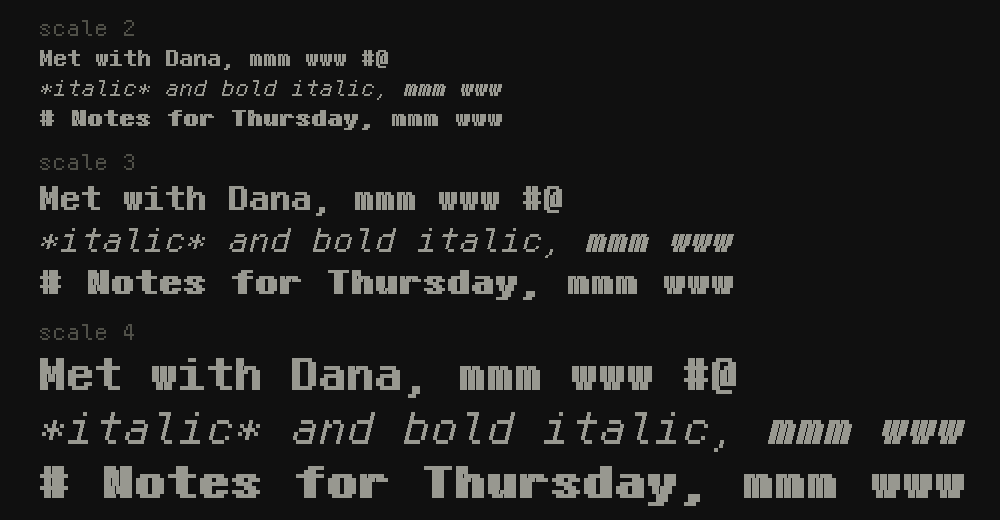
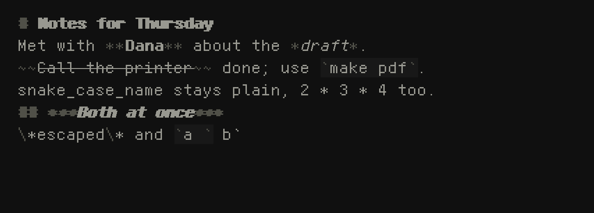

# Writerdeck for the M5Stack Tab5: software spec

A discreet capture device for getting notes down where a phone shouldn't come out. Standalone ESP-IDF 6.1 firmware for the Tab5 (ESP32-P4, **chip rev v1.3**), a USB keyboard on the USB-A host, text on the SD card, and notes emailed out on a schedule.

Priorities, in order: **never lose a word**, **instant to a cursor**, **discreet**, **battery life**.

**Built so far** (0001-0044): the editor in daily mode and file mode's notes page (section 5), the mirrored log with recovery and export (section 4), the spelling check and its dictionary download (section 5), and the settings page's email account, test email, rotation and library table (section 7). *0051:* the power model, scheduled sends and idle dim, dark and power-off (sections 2, 3, 5), with "sent" kept in NVS (`sentname`, `sentseq`) until checkpoints exist; idle steps 2, 5 and 20 minutes, in the editor only. **Not yet:** background sends and checkpoints (section 6), the highlight-mode picker and TeX highlighting, setting the clock. The sections below are the design, built or not.

## 1. Hard constraints

- ESP-IDF 6.1. `sdkconfig.defaults` must contain `CONFIG_ESP32P4_SELECTS_REV_LESS_V3=y` and `CONFIG_ESP32P4_REV_MIN_100=y`. Delete `sdkconfig` after changing them.
- Standalone firmware, linking components from `Sudrien/feckless-libs-for-m5tab5` directly. Do not depend on the ELF-launcher ABI. Name each component at the same tag in `main/idf_component.yml`:
  - `feckless_drivers`: USB HID host, RX8130 RTC, battery, touch, `tab5io`
  - `feckless_graphics_handler`: panel, backlight, gfx (text scaling works)
  - `feckless_storage_handler`: SD arbiter (lease the volume per operation; never hold it open)
  - `feckless_network_handler`: Wi-Fi via the C6, saved networks in NVS
  - `feckless_mail`: SMTP and the email account (`mailcfg`, `mailform`)
  - `feckless_keyboard`: the on-screen keyboard that `mailform` links (off here; the USB keyboard types)
  - `feckless_nvs_handler`, `feckless_libversions`, plus the by-name deps each one lists (`usb_host_uac`, `usb_host_msc`, `fatfs` for exFAT)
- `espressif/esp_hosted` is held at `>=3.0.7,<3.1.0` in the same manifest (0016): 3.1.0's fixed 1536-byte SDIO receive buffers drop the Tab5's C6's batched reads, and no TLS connection opens.
- Call `tab5io_init()` first thing in `app_main()`.
- **No RTC/LP/HP memory survives any reset** on this board. Do not rely on `RTC_DATA_ATTR`, `RTC_NOINIT_ATTR`, or `__NOINIT_ATTR`.
- The reset reason is useless. Every restart reports `WDT` (7), or `USB` (11) after a flash. Deep sleep does not work as a wake model on this board.

## 2. Power model (measured on hardware)

**Sleep = soft power-off with an RX8130 alarm armed.** A full power-down that the RTC can undo.

Measured results:
| Fact | Evidence |
|---|---|
| Pulsing `PWROFF_PULSE` (expander 0x44, P4) powers the board off, with or without USB-C | serial port disappeared; no reboot |
| The RX8130 **alarm** powers the board back on, unattended | boot 13: AF set, booted 3 s after the alarm time |
| The RX8130 **timer** fires (TF sets) but does **not** power the board on | boots 9→10 and 13→, board stayed off until the button was pressed |
| Alarm registers: minute (0x17), hour (0x18), weekday/day (0x19 = `0x80` to ignore), `EXT` WADA=0, `FLAG` AF=0x08, `CTRL0` AIE=0x08 | verified by readback |

**Rules**
1. **Use the alarm only.** Keep `CTRL0` TIE/UIE off and `EXT` TE off at all times, so no stray flags accumulate.
2. Before every power-off that arms the alarm, in this order: clear AF, write the next alarm time, set AIE, then pulse off. A stale alarm time or flag caused confusing boots in testing.
3. The alarm has **minute resolution**. That is fine for hourly sends. The next alarm time is computed **relative to the RTC reading** (see section 3), so it stays correct even if the RTC's absolute time is wrong.
4. **Arm the alarm only if there is something to send:** the log is dirty *and* email is configured. Otherwise power off with AIE off. Nothing can change while the board is off (only the power button starts it), so a wake with nothing to send would cost a full boot for no reason.
5. **On every boot that reaches the editor, clear AF and disable AIE** before doing anything else. Otherwise an alarm that comes due while the user is typing leaves AF set, and a later crash or WDT reset (the reset reason is useless, section 1) would be mistaken for a scheduled wake and power the board off mid-sentence.
6. Power-off pulse that worked in testing: configure P4 of expander 0x44 as output, take it out of high-Z, drive it high for ~500 ms, then low. Retry if the board is still running after a second.
7. The power button powers the board on. A USB keyboard cannot.

## 3. Boot flow and the send schedule

```
power on
  tab5io_init()
  rtc8130 init; read FLAG register
  if AF set:                        # scheduled wake, screen stays dark
      clear AF, disable AIE
      mount SD (lease); recover the log (section 4)
      dirty = log has ops after its last checkpoint     # the card decides
      if !dirty:  power off, no alarm
      else:       bring up Wi-Fi, send (section 6),
                  on success: append a checkpoint, power off, no alarm
                  on failure: arm the alarm at backoff, power off
      store the result (section 6) in NVS
  else:                             # user power-on
      clear AF, disable AIE
      init display, SD, USB HID
      recover the log; reconcile NVS against it
      open the editor (section 5); if dirty, schedule a background send
```

- The scheduled path never initializes the display, touch, or USB host.
- **The interval is not wall-clock time.** It runs from the last boot or send attempt, measured on the RTC (or on uptime while the editor is up). There is no top-of-the-hour alignment, and NTP (0049) only sets the clock; it does not move the schedule. At power-off the next alarm is `RTC now + interval`, rounded to the minute. Every boot, scheduled or user, is a point where "has anything changed since the last checkpoint" is evaluated.
- **Time budget:** give the whole send path a hard cap (suggest 45 s). On timeout, count it as a failure and apply backoff.
- **Backoff:** normal interval is 1 h (configurable). On failure, double up to a **2 h maximum**. Reset to normal on success. On a dark wake the failure is silent; its result is kept for the next editor open (section 6).
- **The card is the source of truth.** `dirty` and `last_sent_seq` in NVS are caches. `dirty` lets an empty wake skip mounting the SD card; `last_sent_seq` mirrors the log's last checkpoint. At every editor boot, recompute both from the log and let the log win. A swapped card or stale NVS must never cause a missed send or a silent duplicate.
- `dirty` is written to NVS only on the clean-to-dirty transition. `last_sent_seq` is written only after a successful send. No per-keystroke NVS writes.

## 4. Storage and history

**The log is the document.** The `.md` or `.tex` file is an *export*, regenerated from the log. If the export is missing or stale, nothing is lost.

- **Two mirrored log dotfiles** next to the export (e.g. `.2026-11-01.md.h0`, `.h1`). Each is a complete log. Every flushed burst is appended to `h0` and `f_sync`ed, then appended to `h1` and `f_sync`ed. Never write both at once, so a power loss can tear the tail of at most one file.
- **Recovery** at every boot: scan both from the start. Take the longest valid prefix of each, use the longer one, and copy its missing tail onto the shorter. A damaged or missing file is rebuilt from its twin. If both are lost but the export survives, rebuild a log from the export as a single insert (history is gone, text is not).
- **Record framing** (LevelDB/SQLite-WAL style): a header, then records of `length, type, seq, time, payload, CRC-32C`, where the CRC chains from the previous record so a stale record from an earlier use of the file cannot validate. Recovery stops at the first bad length or CRC.
- **Preallocate** the log (`f_expand`) and ignore the FAT directory size. Recovery scans records until the CRC fails or it reaches zeros. This is robust to a power loss between a cluster-chain extension and the directory-entry update, which FAT does not make atomic.
- **Ops:** timestamped inserts and deletes as `(pos, bytes)`, coalesced by typing burst and flushed when typing pauses. Each record also carries the document length before and after (as Etherpad's changesets do), so replay can detect an intact record applied against the wrong base. This is the full creation history and supports replay. Lengths are in bytes (UTF-8). Each record also says **who made it**: the user, or the spelling check (a correction taken from its suggestions, logged as a changeset of its own). Older records, with 0 there, are the user's. **The user's changesets are credited by name** (0035): the name set on the settings page, "user" until one is. A name is written once per log, as an author record (Easysync's pool entry: an id and the name) just before the first changeset that carries its id; a log edited only under the default has none, and stays readable by firmware before 0035, which would stop at an author record and write over it.
- **Checkpoint = a successful send.** A checkpoint record `{seq S, time, hash of the text at S}` is appended to both mirrors after, and only after, a send of everything through `S` succeeds. It may carry the full text to speed replay. A checkpoint names a seq, not the end of the log, so typing may continue past `S` while a send runs. Ops before a checkpoint are never pruned automatically.
- Log header stores: format version, doc id, highlight mode, creation time, last export hash. *Built (0036):* the header's export-hash field stays 0. The header's CRC seeds the record chain, so it is written once and never rewritten; the hash lives in a hidden sidecar, `.name.ext.x`, instead (below).
- Sequence numbers are monotonic per document and are what email "sent up to" refers to. They are the authoritative order; timestamps are advisory.
- **Export** replays the log to text, writes `name.ext.tmp`, `f_sync`s, then replaces the old file (FatFs cannot rename over an existing file, so unlink then rename; the brief gap is harmless because the log has everything). Export runs on a typing pause, at idle power-off, before an email, at midnight rollover, and on demand. *Built (0036):* 5 s after the last keystroke once the log has it, on Cmd+S, and before the settings page; the rest come with what they belong to. **The export's footer** (0037), never in the log: after the text, a blank line and a `---` rule, then `author: <name>` when the attribution is not the default (section 7), `exported: YYYY-MM-DD HH:MM` from the RTC unless it reports lost time, and `Jinxed Writer <version>`; each line ends in two spaces, so each stands alone in rendered markdown. An import drops a footer of exactly that shape, so footers never pile up in the text. An export whose text is unchanged is not rewritten for a new time. The export extension is the target format (`.md`, `.tex`, otherwise `.txt`); highlight mode lives in the header.
- **External edits:** the hash of the last export is stored in the log. If the export file differs from it at export time, do not overwrite it. Write `name.conflict.ext` beside it and leave the original alone. Importing external edits as ops is a possible later feature. *Built (0036):* the sidecar holds the CRC-32C of the export as last written and of one being put in place, so a power cut between the rename and the record is not taken for an outside edit. An import records its file as already exported. The status line says `conflict` until an export lands; it lands once the outside file is moved away or holds the log's text. A file imported before 0036 has no sidecar, so its first export is a conflict, once.
- **Importing existing files:** a document with no log gets one created with the file as a single insert op, timestamped with the file's modification time.
- **Delete moves** the export and both log dotfiles into a trash folder. It never erases.
- Time comes from the RX8130. *0049:* it is set by NTP whenever the radio is up -- once at boot, and during every send and dictionary download -- a reply before 2026 not believed; with no network it keeps its own time. *0048:* it sets the system clock at boot when it can vouch for its time, so FatFs dates the files it writes; before that every file was dated 1980-01-01. If the chip reports VLF (lost time), mark the affected log entries' timestamps as untrusted rather than inventing a clock. `seq` is unaffected. The settings page must let the user set the clock by hand, since the daily filename and midnight rollover depend on it -- for a device that never sees a network.

## 5. Modes and the editor

**Daily mode:** one file per date, `YYYY-MM-DD.md`. Opening lands the cursor at the end of today's file, with an auto-inserted time marker if there has been a gap. Midnight rollover: keep appending to the previous day until a typing pause, so a thought is never split. **File mode:** basic management only: new, open (recent first), rename, delete (to trash), show size and last-modified. *Built (0044):* the notes page, Cmd+O in either mode: feckless_chooser (9012) over `jinxed/`, the notes (`.md`, `.txt`, `.tex`) newest first with size and date, conflict files dim, folders (the trash, the dictionary) and the logs' dotfiles never shown. Enter or a tap opens; Cmd+N names a new note; Cmd+R renames (0046: not F2 -- the F keys are the editor's); Delete, or Cmd+Delete on an Apple keyboard, moves to `jinxed/trash/` once Y is pressed; Esc or Cmd+O goes back. A note is its export, both twins, the sidecar and its conflict file, and they move together (`doclog_rename()`, `doclog_trash()`: the logs before the export, so a cut leaves the text under both names, never none; a name already in the trash gets `-2`). A name is letters, digits, space and `- _ . ( ) ' ,`, up to 48 bytes, `.md` added when it has none of the three. The page waits while the editor has text the card does not, and the editor keeps its cursor and undo when it comes back to the same note unchanged. In file mode, power-on opens the note last opened, kept in NVS (`jinxed`, `file`), or `notes.md`; daily mode still opens today's, whatever Cmd+O opened before.

Which mode the device runs in is chosen on the **settings page** (section 7) and stored in NVS. There is no boot-time hotkey.

**Editor**
- Text is drawn with gfx and **scaled up from the 12px pixel font** to something comfortable on 1280x720. Scale is a setting.
- Dim, dark, low-contrast theme. No sounds, no notifications. Auto-dim, then blank, after an idle timeout. The status line shows the word count, plus one deliberate exception: the transient send result (section 6). *0047:* and the open note's name, dim, right-aligned before the word count, while no send result is there; not on the bare page (F11).
- Idle timeout ends in the power-off sequence from section 2. Before it, flush the log and run an export.
- **Highlighting has three modes:** none, markdown with `$math$`, TeX. Default for a new note is **none**. The mode comes from the document's extension when the log is created (`.md`, `.tex`, otherwise none), is stored in the log header, and is changeable from the settings page. **There are no hotkeys for switching modes yet.** Leave a clear hook for adding one later.
- **Markdown, built** (0031): `**bold**` / `__bold__` bold, `*italic*` / `_italic_` italic, `***both***`, `~~struck~~` with a line through the x-height, `` `code` `` on a faint band (COL_FIELD), and `#` to `######` headings in heavy. The markers stay, drawn dim, so every byte on screen is a byte in the file and the cursor's columns hold. CommonMark's flanking rules, so `2 * 3 * 4` is plain and an underscore inside a word (`snake_case_name`) never opens or closes anything; GFM's double tilde only; a backslash before ASCII punctuation makes it plain. One line at a time: nothing crosses a newline. Drawn by feckless-libs' `gfx_draw_text_style()` (9006-9008): bold adds a font pixel to the right of every lit one, drawn a screen pixel short where it would close a one-pixel gap, so m, w and @ stay open; heavy does that twice and puts a font pixel between letters, so a heading's rows are in wider cells (`GFX_HEAVY_W`) and wrap sooner, and the cursor and the spelling mark follow them (0032); italic is a shear. The look was settled by previews: `bold.png` is bold, italic, bold italic and heavy at sizes 2 to 4, and `markdown.png` the editor's markdown at size 3, both drawn by that code.




 `md.c`, with a host test in `test/run.sh`. A **Highlighting** row on the settings page, Markdown or None, kept in NVS (`jinxed`, `markdown`), on out of the box, stands where the three-mode picker below will go; that decision is put off.
- **Highlighter:** line-based tokenizer on visible lines only, with small carried state for open `$$` blocks and code fences, and a bounded look-back for multi-line constructs. Muted palette: 2-3 dim tones (structure, math/commands, comments).
- **Math rules (Pandoc style):** an opening `$` must be followed by a non-space; a closing `$` must be preceded by a non-space and not followed by a digit; `\$` is a literal dollar. Inline `$...$` never crosses a line. An unmatched `$` is plain text. Backtick code spans and fences win over math.
- **Spelling is checked on demand, never as you type:** no marks in the text. F7 (Word), and Command+; on an Apple keyboard (the Mac's "check document now") splits the screen: the text in the top half with the word marked, the word and up to five suggestions in the bottom half. The check starts at the word at the cursor and goes round the document to it once. A change is an ordinary edit, but logged on its own and attributed to the checker (section 4); if it cannot be flushed apart from the user's edits around it (no card), the combined changeset is the user's. A Capitalised word gets a Capitalised suggestion.
- **Not checked, as not prose:** single letters, words in capitals (acronyms), words with a capital inside (identifiers), and any word in a run of non-space characters holding a digit, `/`, `\`, `@`, `_`, a backtick, `<`, `>` or `=` (paths, addresses, code, TeX). A contraction is right when its stem is (*don't*, *isn't*, *we'll*).
- **The checker is SymSpell** (edit distance 2, prefix 7, ranked by distance then frequency), written for this board. symspell-c99 itself is not linked: it allocates two 128 MB arenas when created and holds about 45 MB at distance 2, against 32 MB of PSRAM. Instead the index is built once on a computer by `m5tab5/tools/spelldict.c` from a word-frequency list, and lives on the card as `jinxed/spell/english.sym`. From symspell-c99's 86,060-word `dictionaries/dictionary.txt` that is 15 MB on the card; its word list, 2 MB, is read into PSRAM at the first check and stays. The delete index stays on the card, read at most ~60 small pieces per misspelling, the volume leased for each one. Checking that a word is right touches only RAM.
- **No dictionary on the card:** the view says so and offers **D** to download it. The send task (section 6) brings Wi-Fi up as for a send and hands the download to feckless's `feckless_fetch` (feckless 9003): `english.sym` from `Sudrien/jinxed-writer-spellcheck-dictionaries` at a pinned commit (`SPELL_DICT_URL` in `spell.h`, a raw.githubusercontent.com URL), https only, TLS checked against IDF's CA bundle, up to three connections in 1 MB stripes. It is written to `english.sym.part`, with a map of what has arrived in `english.sym.part.id`; when whole it is checked (header, and its sections adding up to the length) and renamed into place, and the check starts. A failure keeps the part file, and **D** again carries on from it; so does a download cut off at ten minutes. A file that fails the check is removed. A dictionary already there is never touched until the new one has passed. **The volume is held for the whole download**, the one exception to section 1's lease: the part file stays open throughout, and an unmount with a file open would be a use-after-free inside FatFs, so a pulled card waits for the download to fail and let go. Any key closes the view and the download goes on; a new dictionary is a new commit there, named in the firmware.
- **Credit** for the algorithm, its C port and the dictionary's sources is in `CREDITS.md`; the dictionary's own notices travel with it, in its repository.
- **The user's words** are `jinxed/spell/words.txt`, one per line, editable by hand. "Ignore all" lasts until power-off.

**Shortcuts.** They follow the keyboard (0027, 0028): **the Mac's on an Apple keyboard, Windows' on any other** -- Word's and Notepad++'s, VS Code's where neither has one. An Apple keyboard is one whose HID report descriptors name an Apple-only key (0025, section 8); until they are read, a moment after it is plugged in, a keyboard is a Windows one. **Cmd** below is the shortcut modifier: **Ctrl** on a Windows keyboard, **Command** on an Apple one. The **Windows key** is a shortcut for nothing: on Windows it belongs to the system. On an Apple keyboard **Ctrl** is a shortcut for nothing: this is a text area, not a macOS text field, and its Emacs keys are not carried over. **Alt** is Option on a Mac keyboard (the same HID modifier); on a Windows keyboard Alt+arrows do nothing, as in Notepad++, whose Alt+Shift+arrows (column select) stay free. Do not assign any mode-switch hotkey.

*Built* (✓) *and planned:*

| Does | Windows keyboard | Apple keyboard | |
|---|---|---|---|
| **Moving** | | | |
| Character left / right | Left / Right | Left / Right | ✓ |
| Line up / down (keeps the column) | Up / Down | Up / Down | ✓ |
| Word back / forward | Ctrl+Left / Right (to a word's start) | Option+Left / Right (to a word's end) | ✓ |
| Paragraph back / forward | Ctrl+Up / Down (to a paragraph's start) | Option+Up / Down (to a paragraph's end) | ✓ |
| Line start / end | Home / End | Command+Left / Right, or Home / End | ✓ |
| Document start / end | Ctrl+Home / End | Command+Up / Down | ✓ |
| Screen up / down | PageUp / PageDown | PageUp / PageDown | ✓ |
| **Deleting** | | | |
| Character before / after | Backspace / Delete | Delete / Fn+Delete | ✓ |
| Word before / after | Ctrl+Backspace / Delete | Option+Delete / Option+Fn+Delete | ✓ |
| To the line's start | -- | Command+Delete | ✓ |
| The whole line | Ctrl+L (Notepad++), or Ctrl+Shift+K (VS Code) | -- | ✓ |
| **Typing** | | | |
| Four spaces / remove up to four leading spaces; over a selection of lines, each line (0039) | Tab / Shift+Tab | Tab / Shift+Tab | ✓ |
| Caps (shown in the status line) | Caps Lock | Caps Lock | ✓ |
| **Selecting** (0033) | | | |
| Extend by character / line / screen | Shift+arrows, Shift+PageUp / PageDown | Shift+arrows, Shift+PageUp / PageDown | ✓ |
| Extend by word / paragraph | Ctrl+Shift+arrows | Option+Shift+arrows | ✓ |
| Extend to the line's start / end | Shift+Home / End | Command+Shift+Left / Right | ✓ |
| Extend to the document's start / end | Ctrl+Shift+Home / End | Command+Shift+Up / Down | ✓ |
| Select all | Ctrl+A | Command+A | ✓ |
| **Editing** | | | |
| Copy / cut / paste | Ctrl+C / X / V | Command+C / X / V | ✓ |
| Undo (0039) | Ctrl+Z | Command+Z | ✓ |
| Redo | Ctrl+Y, or Ctrl+Shift+Z | Command+Shift+Z | ✓ |
| **The document and the app** | | | |
| Check spelling (above) | F7 | Command+;, or F7 | ✓ |
| Settings | Ctrl+, (VS Code's) | Command+, | ✓ |
| The notes: open, new, rename, delete (0044) | Ctrl+O | Command+O | ✓ |
| A new note, named (0045: from the editor too; Esc goes back to the note, a name taken goes to the list) | Ctrl+N | Command+N | ✓ |
| Text larger / smaller, number row or keypad (0022) | Ctrl+= / Ctrl+- | Command+= / Command+- | ✓ |
| Save now (flush the log, then export) | Ctrl+S | Command+S | ✓ |
| Find; next / previous (0039) | Ctrl+F; F3 / Shift+F3 | Command+F; Command+G / Command+Shift+G, or F3 / Shift+F3 | ✓ |
| Send now (file mode's manual send; daily mode's too, 0038) | Ctrl+Enter | Command+Enter | ✓ |
| **F keys** (0029: never the only way to something, but for these three, which have nowhere else to be) | | | |
| These keys: this keyboard's column of this table, built rows only; any key or a tap closes | F1 | F1 | ✓ |
| Bare page: no word count and no gear, the status line's row given to the text -- it comes back while there is no keyboard, caps, no card or not saved; until power-off | F11 | F11 | ✓ |
| Page stats: the document, words, characters (with and without spaces), paragraphs, wrapped lines, the cursor's line and column, size against the 256 KB limit, reading time at 230 words a minute | F12 | F12 | ✓ |

Held keys repeat. A chord with Ctrl, Command, Alt or the Windows key types nothing.

*On the settings page, today:* Up/Down scroll; PageUp/PageDown scroll a screen; Home/End jump to the top and bottom, and so do Ctrl+Home/End on a Windows keyboard and Command+Up/Down on an Apple one; Enter opens the email form; Cmd+T sends a test email; Cmd+Enter sends today's notes; Cmd+N changes the attribution name; Cmd+R turns the screen a quarter clockwise; Esc or Cmd+, closes the page. In the email form: Tab / Shift+Tab or Up / Down move between fields, Enter saves, Esc cancels.

*In the spelling view, today:* 1-9 change the word to that suggestion; Up/Down choose one and Enter takes it; **E** opens a field with the word in it, to type it as it should be when no suggestion is (letters, Backspace, Delete, Left/Right, Home/End, Caps Lock; Enter changes the word to what is typed, Esc goes back to the suggestions) -- a word typed is the user's change in the log, not the checker's; Tab, Space or Right skip the word; I ignores it everywhere until power-off; A adds it to the user's words; Esc or F7 close, and Command+; on an Apple keyboard. When nothing is left, any key closes.

*Decisions recorded.*
- **The keyboard decides the habits** (0027, 0028). A Windows keyboard gets Windows': Ctrl for words, paragraphs and the document's ends, Home / End for the line; the Windows key and Alt do nothing. An Apple keyboard gets the Mac's: Command for the line and the document, Option for words and paragraphs, Ctrl for nothing. 0024 had made Ctrl, the Windows key and Command one, with Mac arrows on every keyboard, because the Windows key and Command send the same HID modifier; the keyboard tells them apart (0025), so that is gone.
- **Where Windows has no standard key**, Notepad++'s comes first, then VS Code's: Ctrl+L and Ctrl+Shift+K both delete the line (Notepad++ uses Ctrl+Shift+K for a block comment, which a plain-text editor does not have). Notepad++'s Ctrl+Up / Down scroll without moving the cursor; Word's paragraph moves were kept for them.
- **Ctrl+; is not the spelling key on Windows** (0028): Word has none, and it is Excel's insert-the-date. F7 is.
- **F keys are extra routes, not the only ones** (0029), except F1, F11 and F12, which have no other key: a 60% keyboard reaches them on its Fn layer, and some "for Mac" keyboards send media keys there unless Fn is held. F2, F4, F10 and Word's F12 (Save As) are not used: rename, repeat, a menu bar and Save As have no meaning here. F12 is page stats.
- **Undo never removes anything from the log** (section 4). It appends a new changeset that reverses the last one, so every word typed stays in the history. *Built (0039):* the history is in RAM, until power-off -- the editor's own edits, not the log's changesets, so undo goes back by what was done rather than by flush. A step is one key's worth (a type-over and its letter, a paste, an indent of many lines), or typing up to where the next word starts, or a run of Backspace or Delete, with no 2 s pause in it; undo puts back what was selected. 1 MB of edits and 8192 of them are kept, the oldest let go first; one edit bigger than that forgets the history. A card whose text is put before RAM's (section 4, attach) clears it, since every position moves.
- **No go to line** (0039): there is no room on the page for line numbers, so a line number would have nothing to point at. Ctrl+G and Command+L stay free.
- **Find** (0039) is a bar in the status line's row: found as typed, from where the cursor was, ignoring case, the match selected; Enter or F3 next, Shift for the one before, round the end; Esc closes it with the match still selected; Cmd+F again closes it too. The query is kept until power-off, so F3 (Cmd+G) finds again with the bar shut.
- **The selection** (0033) runs from where Shift was first held with a movement to the cursor, drawn behind the text as the spelling mark is; a selected newline shows as one cell. A movement without Shift ends it, and plain Left / Right go to its start / end. Typing, Enter and Tab replace it; Backspace and Delete, with or without the word modifier, delete it and only it. Any edit, and the spelling check, end it. Copy with nothing selected does nothing (Word's way, not VS Code's copy-the-line).
- **The clipboard is RAM only**, one TEXT_MAX buffer in PSRAM, kept until power-off and never written to the card. Nothing outside the Tab5 can paste into it or from it. A paste that would pass the 256 KB limit does nothing.
- **Not carried over from Word:** bold, italic, underline, alignment, styles, page breaks, tables, print. The text is plain.
- **No Emacs keys on an Apple keyboard** (Ctrl+A / E / K): macOS gives them to its text fields; this is a text area, and Command covers the same ground (0028).

## 6. Email

- SMTP over TLS, linked directly (mbedtls / esp-tls). Send only. Wi-Fi is up only for the duration of a send (or a dictionary download, section 5), then dropped. *0049:* and once at boot for the time: up to 20 s to join a saved network and 8 s for an NTP reply, then down, with nothing on the screen; a send asked for meanwhile says busy.
- **What is sent (daily mode):** the net difference between the text at the previous checkpoint and the text now, so text typed and then deleted within the interval is never sent. Plus a full copy on manual send. No changes since the last checkpoint means no attempt, no Wi-Fi, and no message.
- **File mode:** manual send only (a hotkey or button), attaching the current export. Optionally attach the log.
- **Manual send, built** (0038): Cmd+Enter in the editor, or Send notes now (or Cmd+Enter) on the settings page, flushes the log, exports, and sends today's whole text with the export's footer through the send task, to the account on the settings page: inline, so a mail reader shows it and a search finds it, and attached as `YYYY-MM-DD.md` with the log, `YYYY-MM-DD.md.h0`, beside it (0041, feckless-libs v0.9.7's `mailsend_with()`). The log is copied on the editor's task as the send starts, so the send never reads a file the editor is appending to; one over 4 MB is left off, and the result line says so. Subject `Jinxed Writer: <file>, seq 1-S`, or `not yet saved` when it could not be flushed. Its progress and result are in the status line, cleared 10 s after it ends or at the next key. No checkpoint is written yet: the background send will need it, and it is a new record type, which firmware before it would stop at.
- Put the sequence range in the subject line so a duplicate after a mid-send reset is obvious. Write the checkpoint only after the send succeeds. If power fails in between, the next attempt duplicates the send, which is acceptable; a missed send is not.
- **Credentials** (host, port, user, app password, recipient) are stored in **encrypted NVS, the same way the saved Wi-Fi networks are**. Follow how `feckless_network_handler` does it; do not invent a second scheme. Never store credentials on the SD card.

**Background send from the editor.** When the editor boots dirty, and then once per interval of uptime while dirty, it attempts a send without touching the screen except for the status line.
- The send runs in its own lower-priority task, so TLS and SMTP never stall typing. The 45 s cap and the backoff apply.
- The editor already holds the text in RAM. At send time it copies the text and the current seq `S` under a brief lock and keeps the previous checkpoint's text in RAM, so the diff needs no SD read.
- **The editor is the only log writer.** The send task reports "sent through S" and the editor appends the checkpoint to both mirrors.

**Status messages** (the only regular interaction the user sees), in the status line with the word count, domain only so the full address is never shown, cleared after about 10 s or on the next keypress. Per attempt, in this order:
1. No saved network in range: `no wifi, did not send to @example.com` (just `no wifi` if email is not configured). Repeats on each attempt, spaced by backoff. This **suppresses** the email message.
2. Wi-Fi available, email not configured: `no email configured`, shown **once per boot**. After it is shown, no further attempts are made while email stays unconfigured. (Until it has been shown, an unconfigured device keeps checking for Wi-Fi at the backoff interval, so the radio use is bounded.)
3. Send succeeded: `sent to @example.com`.

A dark wake cannot show a message. Its outcome (a result code and time, a few bytes) is stored in NVS and shown for a few seconds when the editor next opens. A dark wake never counts as having shown the once-per-boot email message. If email is not configured, the alarm is not armed at all (section 2, rule 4).

## 7. Settings page

Reached from a **gear icon** (touch) and also from the keyboard. At minimum:
- Mode select: **Daily** or **File** -- *built (0044):* two buttons, kept in NVS (`jinxed`, `mode`), daily out of the box, from the next power-on
- Daily-mode flush interval (default 1 h; 2 h backoff cap is fixed)
- Highlight mode for the current document (none / markdown+math / TeX)
- **Which way up** (0019): Landscape, Landscape flipped, Portrait, Portrait flipped -- four buttons, the current one lit; a tap turns the screen and the touch at once, and the angle is kept in NVS (namespace `jinxed`) and applied from the first frame of the next boot. Landscape out of the box. The editor re-measures its columns and rows on leaving the page. Narrow, the page and the spelling pane wrap what does not fit: the spelling legend breaks between its keys, the status lines take two lines, a library is two lines (its name, then checkout and licence), and the typing field scrolls with its cursor.
- **Text size** (0022): the editor's text, ark12 at 2 to 5 times (24 to 60 px), 3 out of the box -- a row of four buttons, or Ctrl+= / Ctrl+- in the editor (Command on an Apple keyboard); kept in NVS (`jinxed`, `scale`). The editor and the spelling view take it, and the status line, the gear and the spelling view's small print go one step smaller (never under 2, and no larger than the status line fits across: at most 3 landscape, 2 portrait). The settings page keeps its own sizes.
- **Theme** (0021): Dark (the default, section 5's dim low-contrast one), Light, Green console, Orange console -- four buttons under the rotation, the current one lit; kept in NVS (namespace `jinxed`, key `theme`) and applied from the first frame of the next boot. The editor, the spelling view, the settings page and the email form all follow it.
- **Attribution** (0035): the name the user's edits are credited to in the log (section 4), up to 32 characters, "user" out of the box; kept in NVS (`jinxed`, `author`). A change applies from the next flush, in whichever day's log that is. The export's footer carries it when it is not the default (0037, section 4).
- Library versions: render the table generated by `feckless_libversions` (`libversions.h` / `libversions.tsv`) with versions and licences, as the library provides it. Drawing it is the app's job.
- Set the clock (NTP sets it when there is a network, 0049; by hand for when there is none; see section 4)
- Email and Wi-Fi setup entry points

Touch is for this page, the file picker, and scrolling. The keyboard does everything else.

## 8. Verify first (not yet confirmed on hardware)

1. **Battery-only alarm wake.** All alarm tests ran with USB-C plugged in. Confirm the alarm wakes the board with USB-C unplugged, battery in.
2. **Charging.** `CHG_EN` is P7 on expander 0x44 and needs the charger configuration code sent to enable charging. `tab5io_init()` handles the basic enable. The same code appears to drive the power-button LED green when power is present. **Open item: the exact code is to be supplied from the project owner's notes.** Check whether the pack charges while the board is soft-off.
3. **SMTP/TLS from the standalone build,** including the time from Wi-Fi up to message sent, against the 45 s cap in section 3, and that a background send does not stall typing. *On a Tab5* (0040's build, a test send over WPA2/WPA3 at -42 dBm): radio on to `mailsend: sent` in 13.4 s, joined at 9.6 s of it. A background send's effect on typing waits for background sends.
4. **NVS encryption** is present and working in this build for the credentials, as it is for the Wi-Fi list.
5. **SD behavior when the card is removed** mid-session: the editor keeps buffering and the log catches up when a card returns. Also verify mirror recovery by cutting power mid-append at random points and checking that one twin always survives and the other is repaired.
6. **Which keyboard** (0025): each one is logged when it comes or at boot -- `kbd: keyboard: <maker> <product> (vvvv:pppp)`, each HID interface's country code and report descriptor, then `kbd: ... Apple-only keys: fn globe` or `no Apple-only keys`. "Apple-only" is read from the report descriptors, not the vendor ID: the Fn key on Apple's vendor page (0x00FF, usage 0x03) or the globe key (Consumer 0x029D). Each key event carries it (`apple`, and `cmd`, the shortcut modifier for that keyboard, 0027); `kbd_apple()` has it for the hints. *On a Tab5,* a PC keyboard (04b4:0510, two HID interfaces, 65- and 170-byte descriptors): `no Apple-only keys`. Still to confirm on an Apple keyboard.
7. **USB HID keyboard layouts:** at least US ANSI, with a Windows keyboard's Ctrl shortcuts and an Apple keyboard's Command ones (0027, 0028).

## 9. Out of scope for now

On-device TeX typesetting, PDF export, note-mode hotkeys, a Wi-Fi AP or web UI, receiving email.

## 10. Test projects already written (for reference)

- `reset_probe`: checks which memory survives which reset. Result: none does.
- `rtc_wake_probe`: arms an RX8130 timer or alarm, then powers off via `PWROFF_PULSE`. Result: alarm works; timer does not wake the board. Its register definitions are a working reference for the alarm code.


## Sort this and elaborate
- Color for syntax highlighting and footer, no low contrast grays. Highlight background can be lower contrast.
- Dark mode, light mode
- configurable font scale (current size is smallest, this is a retina display)
- fake bold and italic & strikethrough for font, markdown basics
- Apple keyboards: detected from their report descriptors (0025, section 8), and given the Mac's keys (0027). The settings page's text-size hint says Cmd or Ctrl to match.
